<p align="center">
  
</p>

<p align="center">
  Say <b>“Hi Dee”</b> and ask about your day, search your email, or have Deelraj draft
  an email or schedule an event. Deelraj always asks before sending or creating anything.
</p>


## What Deelraj does

| Feature | What it does |
|---|---|
| **Wake phrase** | Turn on Hands-free and say “Hi Dee”, or tap the microphone button |
| **Siri-style screen** | No text, just a black screen with a glowing wave and two buttons: microphone and hands-free |
| **Calendar and email** | Check your schedule, search and read email, all by voice |
| **Confirmation first** | Emails and events are only sent or created after you say yes |
| **Natural replies** | Short, friendly answers, and follow-up questions work |


## Set it up

**1. Google (one time)**

1. Create a project at https://console.cloud.google.com
2. Enable the **Gmail API** and the **Google Calendar API**
3. Set up the OAuth consent screen (External) and add yourself as a test user
4. Create an **OAuth client ID** of type Web application with this redirect URI:
   `http://localhost:5000/oauth2callback`
5. Download the JSON and save it in this folder as `credentials.json`

**2. Run it**

```bash
python -m venv .venv
source .venv/bin/activate        # Windows: .venv\Scripts\activate
pip install -r requirements.txt
cp .env.example .env             # then add your Anthropic API key and timezone
python app.py
```

Open http://localhost:5000 in Chrome, Edge or Safari, click **Connect Google account**,
then tap the microphone button or switch on **Hands-free** and say “Hi Dee”.


## Using it on a Mac

This GitHub page only describes the project. **You talk to Deelraj on your own computer**, not here.

```bash
cd ~/Downloads/deelraj             # the folder you unzipped
python3 -m venv .venv
source .venv/bin/activate
pip install -r requirements.txt
cp .env.example .env               # then open .env and paste your Anthropic API key
python app.py
```

Then open **http://localhost:5000 in Chrome** (not the file itself, and not this GitHub page).

- You can test the voice with just the Anthropic key. Connect Google later using the button at the top right.
- If the microphone does not respond, click **Allow** when Chrome asks, then check
  System Settings > Privacy & Security > Microphone and switch on Chrome.
- Safari's speech recognition is unreliable, so use Chrome.


## Talking to Deelraj

- Say “Hi Dee”. Deelraj answers “Hi, how are you today?”, listens to your reply, then asks “How may I help you today?”
- Or all at once: “Hi Dee, what’s on my calendar tomorrow?”
- After the answer Deelraj keeps listening briefly, so you can ask a follow-up
- When Deelraj drafts an email or event, say “yes” or “cancel”, or use the buttons
- Everything is spoken, so there is no text on screen except when Deelraj is about to send an email or add an event

## How it works

- `static/index.html` is the interface. It uses the browser’s speech recognition and
  speech synthesis, and draws the animated wave on a canvas.
- `app.py` is a Flask server. It sends your words to Claude with tools for Gmail and
  Calendar, runs the tools Claude asks for, and returns a short reply to speak.


## Safety

- Sending an email or creating an event needs your confirmation. The model cannot
  confirm for itself.
- Minimal Google permissions: read mail, send mail, edit calendar events
- Email text is treated as untrusted and never followed as instructions
- Runs only on your own machine (127.0.0.1)

**Never commit `.env`, `credentials.json` or `token.json`.** They hold your API key and
Google access. The included `.gitignore` already excludes them.

## Notes

- With Hands-free on, your browser listens continuously for the wake phrase and its speech
  service processes that audio. Turn it off when you don’t need it.
- Voice input works in Chrome, Edge and Safari.
- Deelraj picks the most pleasant female English voice your browser has. For a richer
  voice on a Mac, download **Ava (Premium)** or **Zoe (Premium)** in System Settings >
  Accessibility > Spoken Content > System Voice > Manage Voices, then reload Chrome.
  To force a voice, add it to the address, for example `http://localhost:5000/?voice=ava`.
- Google may show an “unverified app” warning because this is your own test project.
- GitHub Pages cannot host this project, because it needs the Python server.
